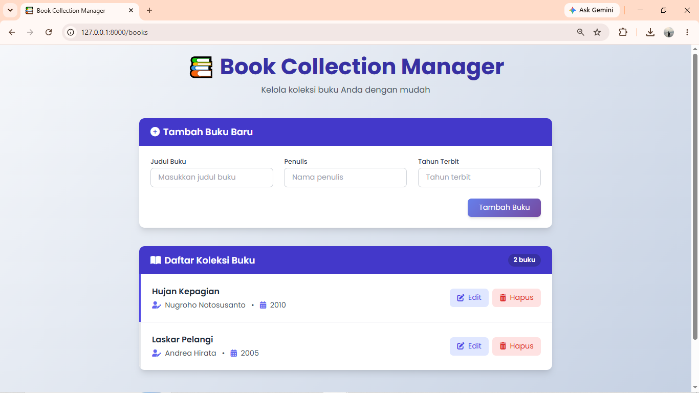

# Book Collection Manager

Aplikasi web sederhana untuk mengelola koleksi buku, mulai dari menambahkan, melihat, mengedit, hingga menghapus data buku.

## Screenshot Aplikasi

## Fitur

- Menambahkan buku
- Melihat daftar buku
- Mengedit data buku
- Menghapus buku

## Teknologi

- PHP
- Laravel
- Blade
- Tailwind CSS

## Status Proyek

Proyek individu untuk portofolio pengembangan web.
